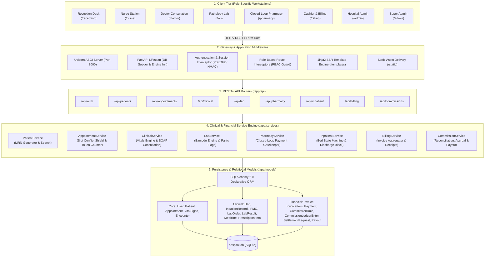
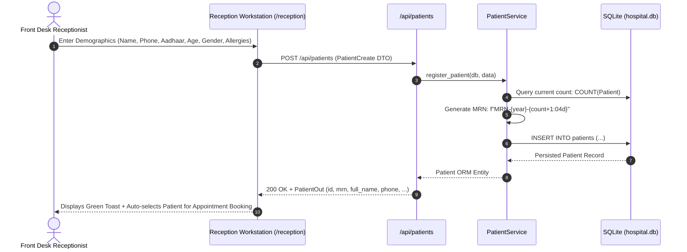
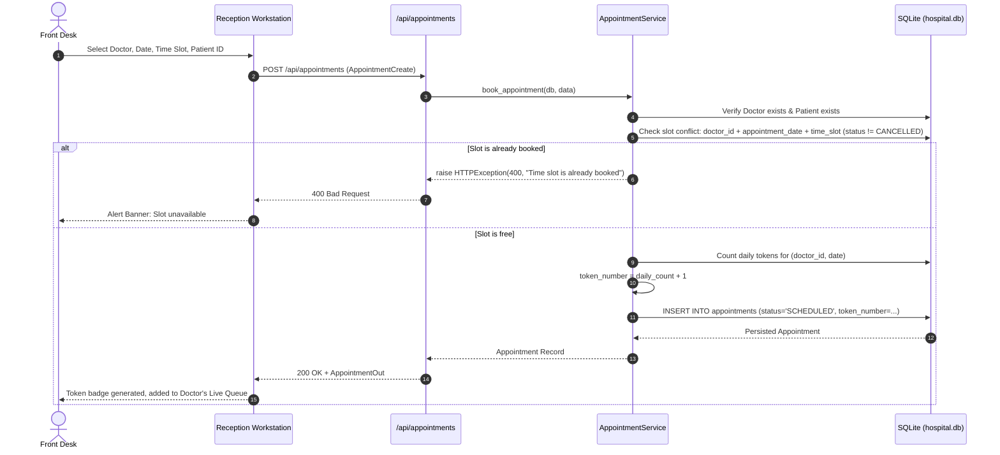
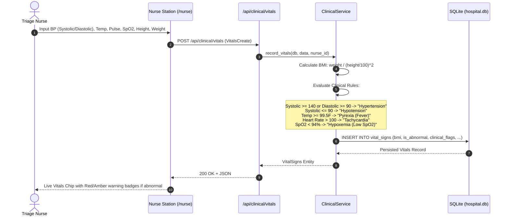
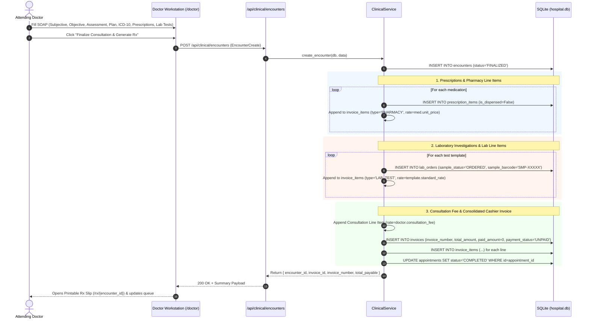
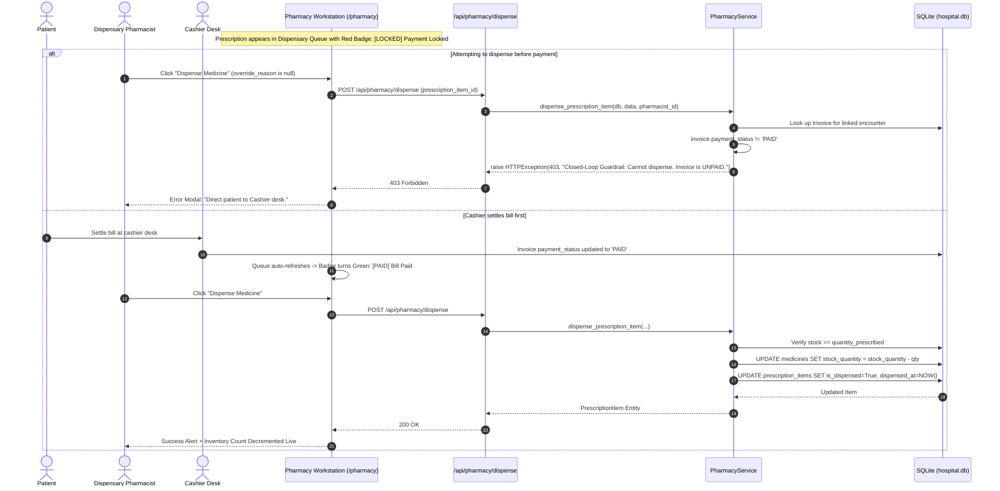
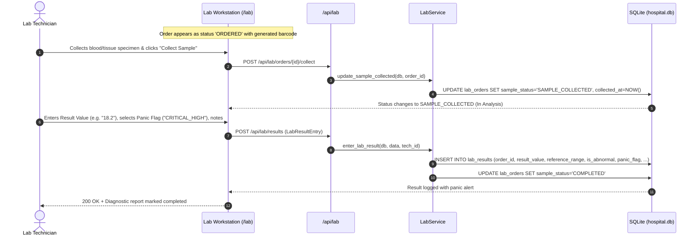
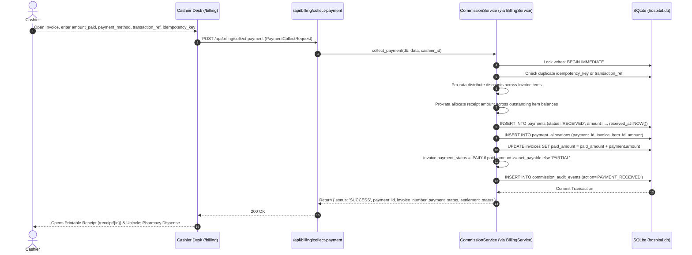
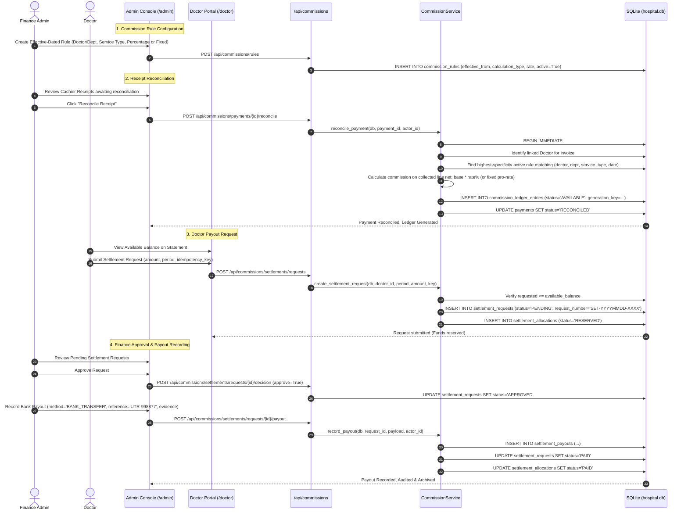

# City Hospital Enterprise HMS — Full Dataflow & Component Specification

> **Document Version:** 2.0.0  
> **System Name:** City Hospital Enterprise Management System (City Hospital HMS)  
> **Architecture Pattern:** Modular Layered Monolith (FastAPI + SQLAlchemy + Semantic Vanilla Web Components)  
> **Database:** SQLite (`hospital.db` with ACID `BEGIN IMMEDIATE` financial transaction serialization)  
> **Verification Status:** Operational & Production-Ready (15/15 Pytest Test Suites Passing)

---

## 1. Global System Architecture & Component Topology

The system is structured into five distinct operational tiers designed to enforce clinical safety invariants, eliminate financial revenue leakage, and deliver sub-millisecond local latency.



---

## 2. End-to-End Dataflows

### Flow 1: Patient Registration & Multi-Parameter Search
The gateway to the hospital workflow. Every patient receives a collision-proof sequential Medical Record Number (MRN).



- **Desired Output:**
  - Database: New row in `patients` table with unique `mrn` (e.g. `MRN-2026-0005`).
  - Response: HTTP `200 OK` returning `{ id, mrn, full_name, phone_number, age, gender, blood_group, allergies, ... }`.
  - UI State: Clears registration form, notifies operator, populates patient lookup for instant appointment scheduling.

---

### Flow 2: Appointment Scheduling & Slot Conflict Guardrail
Guarantees zero double-booking per doctor time slot and issues sequential daily queue tokens.



- **Desired Output:**
  - Conflict Case: HTTP `400 Bad Request` with clear message: `"Time slot 10:00 - 10:15 is already booked for Dr. Sharma on 2026-10-21."`
  - Success Case: HTTP `200 OK` with unique `token_number` (1, 2, 3...) per doctor-day, `status="SCHEDULED"`.

---

### Flow 3: Nursing Triage & Physiological Vitals Evaluation
Computes Body Mass Index (BMI) automatically, evaluates threshold limits, and sets clinical anomaly flags.



- **Desired Output:**
  - Database: New record in `vital_signs` with `is_abnormal: bool`, `bmi: float`, `clinical_flags: "Hypertension, Hypoxemia"`.
  - UI State: Instant visual indicator on doctor's queue and triage log alerting clinical staff to patient instability.

---

### Flow 4: Doctor SOAP Consultation, Orders & Consolidated Invoice Generation
The clinical core. Simultaneously captures SOAP documentation, prescribes medications, orders lab diagnostics, updates appointment queue, and synthesizes the consolidated cashier invoice.



- **Desired Output:**
  - Encounter: Finalized clinical record with diagnostic code.
  - Prescriptions: `prescription_items` created with `is_dispensed = False` (locked until billing settlement).
  - Lab Orders: `lab_orders` created with unique barcode (`SMP-XXXXX`) and status `ORDERED`.
  - Billing: Consolidated `invoices` row (`INV-2026-XXXX`) with `payment_status="UNPAID"` combining consultation, lab, and pharmacy charges.
  - Appointment: Transitioned to `COMPLETED`.

---

### Flow 5: Closed-Loop Pharmacy Dispensing Guardrail
Strict invariant preventing unauthorized drug delivery without prior cashier settlement.



- **Desired Output:**
  - Unpaid Attempt: HTTP `403 Forbidden` with detailed rejection explanation.
  - Paid Execution:
    - `prescription_items.is_dispensed = True`, `dispensed_at = TIMESTAMP`, `dispensed_by_id = PHARMACIST_ID`.
    - `medicines.stock_quantity` decremented by prescribed count.
    - Real-time inventory run-out forecasts updated in Pharmacy Analytics.

---

### Flow 6: Pathology Laboratory Diagnostic Pipeline
End-to-end specimen collection, technician result entry, and automated reference-boundary/panic-threshold flagging.



- **Desired Output:**
  - Database: `lab_orders.sample_status = "COMPLETED"`; `lab_results` record storing tested numerical/text value, reference range, abnormal flag, and technician notes.
  - Doctor EHR UI: Patient's clinical chart immediately reflects the lab findings with colored panic indicators.

---

### Flow 7: Inpatient (IPD) Admission, Bed Turnaround State Machine & Discharge Clearance Block
Enforces the 3-state bed progression (`VACANT` $\rightarrow$ `OCCUPIED` $\rightarrow$ `CLEANING` $\rightarrow$ `VACANT`) and prevents discharge with unbilled stay charges, pending medication orders (IPMO), or open lab tests.

```mermaid
sequenceDiagram
    autonumber
    actor Doctor as Doctor / Nurse
    participant UI as Inpatient / Nurse Workstation
    participant API as /api/inpatient
    participant Svc as InpatientService
    participant DB as SQLite (hospital.db)

    Doctor->>UI: Select Patient & Available Bed
    UI->>API: POST /api/inpatient/admissions (AdmissionCreate)
    API->>Svc: admit_patient(db, data)
    Svc->>DB: Verify bed.status == 'VACANT'
    Svc->>DB: INSERT INTO inpatient_records (ip_number, status='ADMITTED', ...)
    Svc->>DB: UPDATE beds SET status='OCCUPIED', current_patient_id=patient_id
    DB-->>UI: 200 OK + Bed turns RED (Occupied)

    Note over Doctor,UI: Patient receives care; nurse administers scheduled IPMO medications

    Doctor->>UI: Request Discharge Clearance
    UI->>API: GET /api/inpatient/records/{id}/clearance
    API->>Svc: check_discharge_clearance(db, record_id)
    Svc->>DB: Check 1: Any unadministered IPMO on nurse chart?
    Svc->>DB: Check 2: Any open/incomplete lab orders for this patient?
    Svc->>DB: Check 3: Any unpaid or partial patient invoices?
    
    alt Outstanding Items Exist & No Override Provided
        Svc-->>API: can_discharge = False, blocking_reasons = [...]
        API-->>UI: 200 OK (Discharge Block Active)
        Doctor->>UI: Attempt POST /api/inpatient/discharge (allow_override=False)
        UI->>API: POST /api/inpatient/discharge
        API->>Svc: discharge_patient(...)
        Svc-->>API: raise HTTPException(403, "Discharge Billing Block Invariant...")
        API-->>UI: 403 Forbidden
    else Clearance Succeeded (or Emergency Override Provided)
        UI->>API: POST /api/inpatient/discharge (discharge_summary, condition)
        API->>Svc: discharge_patient(...)
        Svc->>Svc: Calculate Bed Stay Days * Bed Daily Rate
        Svc->>DB: INSERT INTO invoices (item_type='BED_CHARGE', status='UNPAID')
        Svc->>DB: UPDATE inpatient_records SET status='DISCHARGED'
        Svc->>DB: UPDATE beds SET status='CLEANING', current_patient_id=NULL
        DB-->>UI: 200 OK + Bed turns AMBER (Cleaning)
    end

    Note over UI: Once sanitized, Nurse toggles Bed status to VACANT (Green)
```

- **Desired Output:**
  - Admission: Bed status = `OCCUPIED`, `inpatient_records` entry created.
  - Discharge Block: HTTP `403 Forbidden` if any medication remains unadministered, lab tests are incomplete, or bills are unpaid.
  - Discharge Cleared:
    - Inpatient Record: `status = "DISCHARGED"`.
    - Bed Status: `CLEANING` (patient unlinked).
    - Inpatient Stay Invoice: Auto-generated with line item for bed days $\times$ daily rate.

---

### Flow 8: Consolidated Cashier Billing & Payment Receipt Allocation
Captures patient payment receipts across Cash, Card, or UPI, handles partial payments and discounts pro-rata across invoice lines, and records an auditable payment event.



- **Desired Output:**
  - Database:
    - New `payments` row (`status = "RECEIVED"`).
    - New `payment_allocations` rows mapping the receipt to specific line items.
    - Updated `invoices.paid_amount` and `payment_status` (`PAID` or `PARTIAL`).
    - New `commission_audit_events` audit record.
  - Downstream Effect: Instantly unlocks the Closed-Loop Pharmacy gatekeeper for any medications linked to this invoice.

---

### Flow 9: Doctor Commission Accrual, Reconciliation, Settlement & Payout Engine
Provides an enterprise, auditable clinician compensation pipeline with effective-dated rules, reconciliation gating, doctor statement isolation, and finance disbursement tracking.



- **Desired Output:**
  - Reconciliation: `payments.status = "RECONCILED"`; immutable `commission_ledger_entries` created with `status = "AVAILABLE"`.
  - Settlement Request: `settlement_requests` created with `status = "PENDING"`; allocations reserved so funds cannot be double-requested.
  - Approval: `settlement_requests.status = "APPROVED"`.
  - Payout: `settlement_payouts` recorded with banking transaction reference and evidence; `settlement_requests.status = "PAID"`. Doctor statement updates in real time.

---

## 3. Comprehensive Component Catalog & Desired Outputs

| Domain | Component / File | Trigger / Input | Internal Processing & Logic | Invariants & Guardrails | Desired Output |
| :--- | :--- | :--- | :--- | :--- | :--- |
| **Auth** | [app/api/auth.py](file:///Users/gauravsingh/Downloads/Production_HMS/Production_HMS/app/api/auth.py)<br/>[app/core/security.py](file:///Users/gauravsingh/Downloads/Production_HMS/Production_HMS/app/core/security.py) | Form/JSON credentials (`username`, `password`) | PBKDF2-HMAC-SHA256 salted password verification; signed HMAC-SHA256 token creation. Sets `access_token` HTTP-only cookie. | Inactive account rejection; invalid signature drop; 12-hour session expiration. | HTTP `200 OK` + `{ access_token, token_type, role, user_id }` + redirect to role workstation. |
| **Patients** | [app/api/patients.py](file:///Users/gauravsingh/Downloads/Production_HMS/Production_HMS/app/api/patients.py)<br/>[app/services/patient_service.py](file:///Users/gauravsingh/Downloads/Production_HMS/Production_HMS/app/services/patient_service.py) | `POST /api/patients` with demographic details | Sequential MRN generator (`MRN-YYYY-XXXX`); multi-parameter lookup indexing Name, Phone, Aadhaar, MRN, and ID. | Unique MRN; sanitized strings; non-empty full name. | HTTP `200 OK` with persisted `PatientOut` object; real-time reception search results. |
| **Appointments** | [app/api/appointments.py](file:///Users/gauravsingh/Downloads/Production_HMS/Production_HMS/app/api/appointments.py)<br/>[app/services/appointment_service.py](file:///Users/gauravsingh/Downloads/Production_HMS/Production_HMS/app/services/appointment_service.py) | `POST /api/appointments` (`doctor_id`, `patient_id`, `date`, `slot`) | Double-booking verification; daily sequential token calculation; queue aggregation. | **Double-Booking Shield:** Single patient per doctor time slot. Excludes cancelled slots. | HTTP `200 OK` with `token_number` and `status="SCHEDULED"`, or `400 Bad Request` if occupied. |
| **Triage & Vitals** | [app/api/clinical.py](file:///Users/gauravsingh/Downloads/Production_HMS/Production_HMS/app/api/clinical.py)<br/>[app/services/clinical_service.py](file:///Users/gauravsingh/Downloads/Production_HMS/Production_HMS/app/services/clinical_service.py) | `POST /api/clinical/vitals` (BP, Temp, HR, SpO2, Ht, Wt) | Automated BMI calculation (`kg/m²`); rule-based evaluation against systolic, diastolic, fever, and hypoxemia limits. | Range checks; mandatory nurse identity logging. | HTTP `200 OK` with `is_abnormal: bool`, `bmi`, and comma-separated `clinical_flags`. |
| **Consultation** | [app/api/clinical.py](file:///Users/gauravsingh/Downloads/Production_HMS/Production_HMS/app/api/clinical.py)<br/>[app/services/clinical_service.py](file:///Users/gauravsingh/Downloads/Production_HMS/Production_HMS/app/services/clinical_service.py) | `POST /api/clinical/encounters` (SOAP, Rx list, Lab IDs) | Creates `Encounter`, unpacks `PrescriptionItem` rows, generates `LabOrder` rows with barcodes, generates consolidated `Invoice`. | Appointment completed automatically; doctor fee attached; items tagged for payment lock. | HTTP `200 OK` with `{ encounter_id, invoice_id, invoice_number, total_payable }`. |
| **Pharmacy** | [app/api/pharmacy.py](file:///Users/gauravsingh/Downloads/Production_HMS/Production_HMS/app/api/pharmacy.py)<br/>[app/services/pharmacy_service.py](file:///Users/gauravsingh/Downloads/Production_HMS/Production_HMS/app/services/pharmacy_service.py) | `POST /api/pharmacy/dispense` (`prescription_item_id`) | Checks invoice payment status; verifies stock availability; decrements formulary count. | **Closed-Loop Guardrail:** Rejects unpaid prescriptions with `403 Forbidden` unless override reason given. | HTTP `200 OK` with `is_dispensed=True`; formulary stock reduced in real time. |
| **Lab Diagnostics** | [app/api/lab.py](file:///Users/gauravsingh/Downloads/Production_HMS/Production_HMS/app/api/lab.py)<br/>[app/services/lab_service.py](file:///Users/gauravsingh/Downloads/Production_HMS/Production_HMS/app/services/lab_service.py) | `POST /api/lab/results` (`order_id`, `result_value`, `panic_flag`) | Links order to test template; records technician notes; marks sample status as `COMPLETED`. | Technician authentication required; panic thresholds highlighted in doctor queue. | HTTP `200 OK` with `LabResult` entity; doctor workstation alerted to abnormal findings. |
| **Inpatient (IPD)** | [app/api/inpatient.py](file:///Users/gauravsingh/Downloads/Production_HMS/Production_HMS/app/api/inpatient.py)<br/>[app/services/inpatient_service.py](file:///Users/gauravsingh/Downloads/Production_HMS/Production_HMS/app/services/inpatient_service.py) | `POST /api/inpatient/admissions`<br/>`POST /api/inpatient/discharge` | Bed allocation; IPMO schedule administration; discharge clearance evaluation; bed charge calculation. | **Discharge Block:** 403 Forbidden if unadministered IPMO, open labs, or unpaid bills exist without override. Bed state: `VACANT` $\rightarrow$ `OCCUPIED` $\rightarrow$ `CLEANING` $\rightarrow$ `VACANT`. | HTTP `200 OK`; Bed matrix turns from red to amber (`CLEANING`); inpatient stay invoice created. |
| **Billing & Cashier** | [app/api/billing.py](file:///Users/gauravsingh/Downloads/Production_HMS/Production_HMS/app/api/billing.py)<br/>[app/services/billing_service.py](file:///Users/gauravsingh/Downloads/Production_HMS/Production_HMS/app/services/billing_service.py) | `POST /api/billing/collect-payment` (Amount, Method, Ref, Key) | Idempotent receipt creation; pro-rata line item allocation; invoice balance calculation; payment status update. | Idempotency key protection; duplicate transaction reference rejection; over-payment lock. | HTTP `200 OK` with `{ status: 'SUCCESS', payment_id, invoice_number, payment_status }`; Printable thermal receipt ready. |
| **Commissions & Payouts** | [app/api/commissions.py](file:///Users/gauravsingh/Downloads/Production_HMS/Production_HMS/app/api/commissions.py)<br/>[app/services/commission_service.py](file:///Users/gauravsingh/Downloads/Production_HMS/Production_HMS/app/services/commission_service.py) | Reconcile receipt; Request settlement; Approve/Reject; Record payout | Specificity-based rule matching; ledger entry accrual; available balance reservation; payout evidence recording. | `BEGIN IMMEDIATE` financial locks; doctor role data isolation; no commission without reconciliation. | HTTP `200 OK`; immutable ledger entries; audited settlement requests; CSV statement exports. |

---

## 4. System Invariants & Enforcement Matrix

```
+---------------------------------------------------------------------------------------------------+
| INVARIANT 1: CLOSED-LOOP PHARMACY DISPENSING                                                      |
| Condition: PrescriptionItem cannot be dispensed if linked Invoice is UNPAID                       |
| Enforcement: PharmacyService.dispense_prescription_item checks invoice.payment_status == 'PAID'    |
| Rejection: HTTP 403 Forbidden ("Direct patient to Cashier desk")                                  |
+---------------------------------------------------------------------------------------------------+
| INVARIANT 2: DOUBLE-BOOKING SLOT SHIELD                                                           |
| Condition: Doctor cannot have 2 scheduled appointments in the same time slot                      |
| Enforcement: AppointmentService.book_appointment checks (doctor_id, date, slot, status!=CANCELLED) |
| Rejection: HTTP 400 Bad Request ("Time slot already booked for Dr. ...")                          |
+---------------------------------------------------------------------------------------------------+
| INVARIANT 3: BED TURNAROUND STATE MACHINE                                                         |
| Condition: Beds must strictly progress VACANT -> OCCUPIED -> CLEANING -> VACANT                   |
| Enforcement: InpatientService validates vacancy before admission, forces CLEANING on discharge    |
| Rejection: HTTP 400 Bad Request ("Bed is currently OCCUPIED / CLEANING")                          |
+---------------------------------------------------------------------------------------------------+
| INVARIANT 4: DISCHARGE BILLING & CLINICAL CLEARANCE BLOCK                                         |
| Condition: Inpatient cannot be discharged with open medication logs, open labs, or unpaid bills  |
| Enforcement: InpatientService.discharge_patient validates 3-point clearance checklist             |
| Rejection: HTTP 403 Forbidden (Audited Emergency Clinical Override available)                    |
+---------------------------------------------------------------------------------------------------+
| INVARIANT 5: RECONCILED-ONLY COMMISSION ACCRUAL                                                   |
| Condition: Doctor commission never accrues on unverified receipts or aggregate legacy balances    |
| Enforcement: CommissionService calculates ledger entries ONLY upon authorized reconciliation      |
| Serialization: BEGIN IMMEDIATE on SQLite ensures concurrency-safe reservations and payouts        |
+---------------------------------------------------------------------------------------------------+
```

---

## 5. Verification & Live Serving Instructions

### Automated Regression Verification
The entire test suite is located in `tests/test_hms_core.py` and `tests/test_commission_workflow.py`.  
Execute the suite with:
```bash
pytest -v
```
**Current Result:** `15 passed, 178 warnings in 2.87s` (100% Passing).

### Launching the Application
Execute from the project workspace root:
```bash
python app.py
```
- **Web Portal:** [http://localhost:8000/](http://localhost:8000/)
- **Interactive OpenAPI Documentation:** [http://localhost:8000/docs](http://localhost:8000/docs)
- **Alternative ReDoc:** [http://localhost:8000/redoc](http://localhost:8000/redoc)
